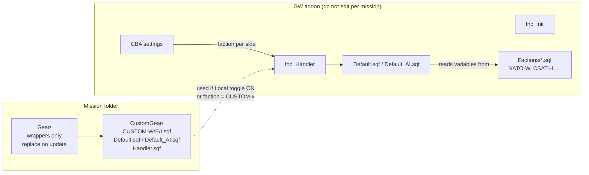
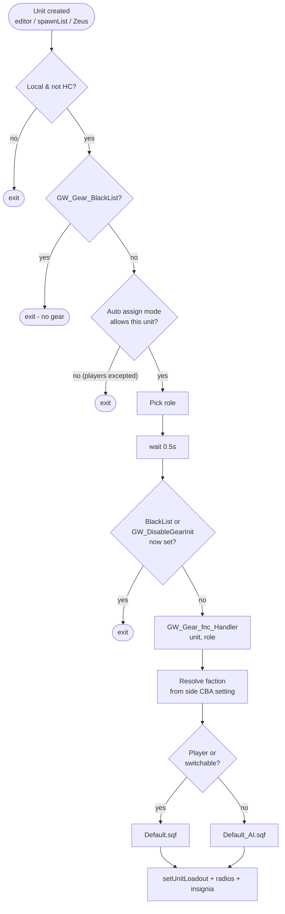
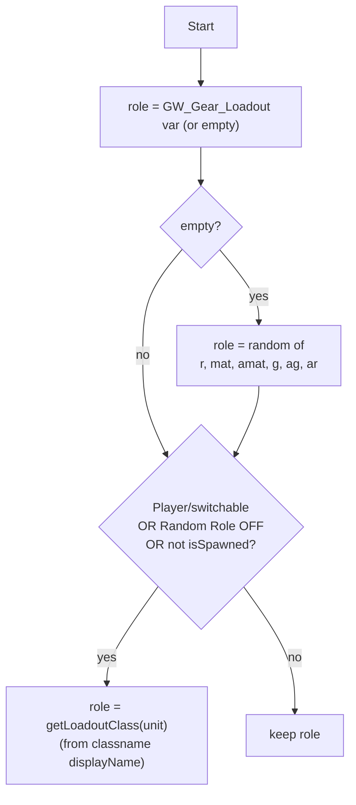
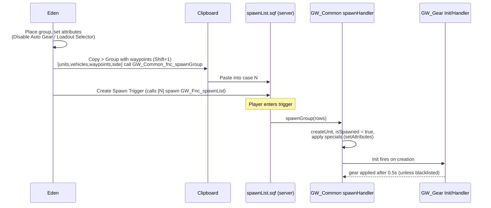

# GOL Gear Framework (4.0)

Gear logic lives in the **GW addon** (`GW_Gear`). The mission only holds what you customise.

Requires: GW addon loaded, mission has `Gear\preInit.sqf` (FW4 marker). No `Gear\preInit.sqf` = addon stands down.

---

## 1. Where things live



| Path | Purpose | Edit? |
|---|---|---|
| `CustomGear/CUSTOM-W/E/I.sqf` | Your own faction kits (West/East/Indep) | Yes |
| `CustomGear/Default.sqf` | Player kit logic (role -> items) | Yes, if Local Default ON |
| `CustomGear/Default_AI.sqf` | AI kit logic | Yes, if Local Default AI ON |
| `CustomGear/Handler.sqf` | Full handler override (crates, etc.) | Yes, if Local Handler ON |
| `Gear/` | Thin wrappers that point at `CustomGear` | No. Overwrite on framework update |

Updating a mission: replace `Gear/`, **never** overwrite `CustomGear/`.

---

## 2. CBA settings (Addon Options > GW Gear)

| Setting | What it does |
|---|---|
| Loadout Blufor / Opfor / Independent / Civilian | Faction kit per side (e.g. `NATO-W`, `CSAT-H`, `CUSTOM-W`) |
| **Auto assign gear** | `Disabled` / `All Units` / `Only Copied Units` / `Ignore Editor Placed` |
| Random Role | Spawned AI get a random role (see section 4) |
| Gives units extra loadout | Medics more supplies, AT more rockets |
| Removes cargo for vehicles | Clears vehicle inventories on init |
| Use Local Default / Default_AI / Handler | Use the `CustomGear` version instead of the addon's |
| Validate unsupported DLC gear | Warn/fallback when a kit item needs DLC/CDLC |
| Stamina modifier / coef | Player load coefficient |

Local toggles are applied after CBA settings init (the addon recompiles functions then), so a mission-level setting is honoured.

### Auto assign modes

| Mode | AI geared | Players / switchable |
|---|---|---|
| Disabled | none | **still geared** |
| All Units | all | geared |
| Only Copied Units | only units spawned via spawn lists (`isSpawned`) | geared |
| Ignore Editor Placed | everything except units existing at `time < 1` | geared |

---

## 3. Runtime flow

Every `AllVehicles` object triggers `GW_Gear_fnc_Init` on creation (CBA class init EH).



The second blacklist check after 0.5 s is what lets a spawn-time `setAttributes` (copied loadout, disable-gear flag) win over auto gear.

### Role selection (`fnc_Init`)



`getLoadoutClass` maps the unit's config displayName to a role: `Squad Leader`->`sl`, `Medic`->`sm`, `Grenadier`->`g`, `Autorifleman`->`ar`, `Rifleman (AT)`->`mat`, `Machine Gunner`->`mmg`, `Crewman`->`crew`, `Helicopter Pilot`->`p`, etc. Anything unmatched = `r`.

### Roles

`pl pm officer fac sl sm ftl r g ag ar ab atab mat amat hat ahat mmg ammg aa dragon lr engineer diver marksman crew p pj jetp drone lightdragon`

---

## 4. Disable auto gear / pick gear

### Eden attributes (unit > Attributes > State/Special)

| Attribute | Variable set | Effect |
|---|---|---|
| **Disable Auto Gear** | `GW_Gear_BlackList = true` | Unit is skipped by Init. Keeps whatever you gave it |
| **Loadout Selector** | `GW_Gear_Loadout = "<role>"` | Intended forced role (see gotchas) |

### Script / init-field equivalents

```sqf
// No auto gear on this unit
this setVariable ["GW_Gear_BlackList", true, true];

// Reliable "force this role": blacklist auto gear, apply handler yourself
this setVariable ["GW_Gear_BlackList", true, true];
[this, "sl"] call GW_Gear_fnc_Handler;

// Force a different faction kit for one unit (3rd arg)
[this, "ar", "RUSSIAN-W"] call GW_Gear_fnc_Handler;

// Re-gear a player mid-mission
[player, "mat"] call GW_Gear_fnc_Handler;
```

| Goal | Do this |
|---|---|
| Whole mission, no AI gear | Auto assign = **Disabled** |
| Only spawn-list AI get gear | Auto assign = **Only Copied Units** |
| Keep editor-placed AI as built | Auto assign = **Ignore Editor Placed** |
| One unit keeps its hand-built loadout | **Disable Auto Gear** on it |
| Vehicle keeps its cargo | `this setVariable ["GW_Disable_autoRemoveCargo", true, true];` |
| Skip Init only (still allow manual handler) | `this setVariable ["GW_DisableGearInit", true, true];` |

### Player role actions (gear box)

Placing a `GOL_GearBox_*` and running `[box, ["gearbox", side]] call GW_Gear_fnc_Handler` fills it and adds the role actions (`Platoon > ...`, `Squad > ...`, `Special > ...`, `Echo > ...`). Each action calls `[player, "<role>"] call GW_Gear_fnc_Handler`. Attachment menus use ACE arsenal boxes, gated by `ARSENAL_ALLOW`, `AirRoles_ALLOW`, `GroundRoles_ALLOW`.

Other crate classes the handler understands: `support_box`, `drone_box`, `tiny_box`, `tiny_box_special`, `small_box`, `med_box`, `med_box_tiny`, `locked`.

---

## 5. Copy and spawn

Build a group in Eden, copy it as code, paste into `spawnList.sqf`, trigger it at runtime.



### Steps

1. Place units/vehicles in Eden. Set side, stance, waypoints, attributes.
2. Select them > **Copy > Group with waypoints...** (`Shift+1`). Code goes to clipboard and is cached; use **Export & Clear Cache** to dump all cached copies. Other copy modes: `Static Units` (`Shift+2`), `Objects` (`Shift+3`), `Loadout` (`Shift+4`, experimental).
3. In `spawnList.sqf`, paste inside a numbered `case`:
   ```sqf
   case 1: {
       [[[[1234,5678,0],90,"Auto",[],"sl"],[[1236,5678,0],90,"Auto",[],"r"]],[],[],east] call GW_Common_fnc_spawnGroup;
   };
   ```
4. In Eden, right-click > **Spawn Lists > Create Spawn Trigger**. It creates `SpawnTrigger_N` (server-only, any player present, 100 m) calling `[N] spawn GW_Fnc_spawnList`. `N` matches the `case`.
5. Delete the originals (or tick **Delete on copy** in Preferences).

### Copy preferences (Preferences > GW Tools: Copy Settings)

| Option | Effect |
|---|---|
| Copy Roles | Writes each unit's role (from classname) into the row. OFF = empty role, random class from faction |
| Delete on copy | Removes selected entities after copy |
| Copy code to Clipboard | Required for paste workflow |

### What the copy stores per unit

Row: `[position, dir, stance, specials, role]`

| Special | Meaning |
|---|---|
| `[202, true]` | Disable Auto Gear (sets `GW_Gear_BlackList`) |
| `[204, getUnitLoadout]` | Exact loadout. **Only exported when Disable Auto Gear is ON.** Applied with `setUnitLoadout` at spawn |
| `[203, "role"]` | Loadout Selector value (sets `GW_Gear_Loadout`) |

So: to spawn a unit with a **specific hand-built kit**, dress it in Eden (or arsenal), tick **Disable Auto Gear**, copy. The kit is baked into the pasted code.

### Spawn rules (`spawnHandler`)

- Class: row role set -> `getClassnameByRole(role, side)` (vanilla class for that role). No role -> leader class for index 0, random from faction list otherwise (`GW_FRAMEWORK >> SpawnUnits >> <faction>`).
- Units are created with simulation off, `isSpawned = true`, then enabled after attributes are set.
- `GOL_SpawnMultiplier` (< 100) randomly thins the unit and vehicle arrays unless `_blacklistMultiplier` is true (5th arg of `spawnGroup`).
- Vehicle crews: tanks get `crew`, air gets `p`.
- Gear faction = CBA setting of the **unit's side**, not the spawn array.

---

## 6. Eden gear preview

On mission save (or the **Refresh Player Gear Preview** menu entry) every unit in the editor is dressed with its side's faction kit so the editor matches the mission.

- Skipped: units with Disable Auto Gear.
- Role: Loadout Selector if set, else inferred from classname.
- Uses local Default/Handler if those toggles are on and the files exist.

---

## 7. Custom factions

1. Set side faction to `CUSTOM-W` / `CUSTOM-E` / `CUSTOM-I` in addon options.
2. Edit `CustomGear/CUSTOM-x.sqf`. It assigns the same variables as `scripts/Factions/*.sqf` in the addon (`_uniform`, `_vest`, `_helmet`, `_rifle`, `_rifle_mag`, `_LAT`, `_nvg`, ...). Arrays = random pick.
3. Use a stock faction file from the addon as a template.
4. Get exact item data from the arsenal: **Export GW Loadout** button writes the variable assignments for the selected/arsenal unit to clipboard.

Role-specific overrides sit at the top of each faction file as `if (_role isEqualTo "...") then { ... }`.

---

## 8. Gotchas (verified against current code)

1. **Forced role is overridden at runtime.** `fnc_Init` reads `GW_Gear_Loadout`, then replaces `_role` with `getLoadoutClass` for players, editor-placed units, or when Random Role is OFF. For spawned AI with Random Role ON it is read *before* spawn-time `setAttributes` sets it, so a random role is picked. Net effect: Loadout Selector only affects the Eden preview and direct `Handler` calls. Use the blacklist + manual `Handler` call pattern from section 4.
2. **Random Role ON ignores copied roles.** Spawned AI roll from `r, mat, amat, g, ag, ar`. Turn Random Role **OFF** to get role-from-classname (which reproduces copied roles).
3. **Auto assign = Disabled does not touch players.** Players/switchable units are always geared.
4. **Disable Auto Gear is per unit**, despite the tooltip saying "Group".
5. Handler is intentionally not CBA-PREP'd so `CustomGear\Handler.sqf` can override it.
6. Gear and Default code are compiled in `Gear\preInit.sqf`; local toggles read there are false until CBA settings init, then recompiled in `CBA_settingsInitialized`. Check the RPT for `[GW_Gear] Configuration` to confirm which source is active.

---

## 9. Debugging

RPT tags: `[GW_Gear][Init]`, `[GW_Gear][Handler]`, `[GW_Gear][DefaultCode]`, `[GW_Gear][DefaultAICode]`, `[GW_Gear] DLC validation`.

Startup prints the active config (handler/default source, factions, auto assign, random, extra, cargo, stamina).

Unit state flags: `GW_Gear_appliedGear` (gear applied), `GOL_SelectedRole` (`[roleId, displayName]`), `GW_Gear_Loadout` (last role).
